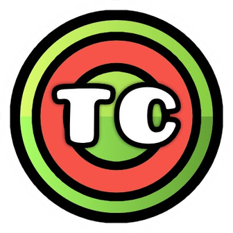

# TrycsCounter



A Geode mod for Geometry Dash 2.2081 that shows how many frames you had for every click in your run, made as close to NaN GD's Frame Window Counter as possible.

The mod is in alpha and I'm still working on it. Found a bug or have an idea how to make it better? Message me on Discord: **kirmgg**

## Download

Get the `.geode` file for your platform from [Releases](../../releases) and put it in the `geode/mods` folder of your game (on Android and iOS, install it through the Geode launcher).

| File | Platform |
|---|---|
| `trycs.counter-windows.geode` | PC (Windows) |
| `trycs.counter-android.geode` | Android, 32 and 64 bit |
| `trycs.counter-ios.geode` | iOS |
| `trycs.counter.geode` | all of the above in one file |

Keep only one of them in the mods folder.

## What is it

The Frame Window Counter a lot of people know. It shows how many frames you had for every click in your run: rings with the window at each click, the counter, the ding and L*.

For even more accurate results, run **Deep Count** after the normal count. It takes longer though.

## How to use

1. Pause > **TC** > **Start Recording** (it turns on practice mode), then play an attempt
2. Pause > **TC** > **Count Windows** and wait (don't click while it counts)
3. Press **Replay** and watch your run with all the windows
4. Optional: **TC** > **Deep Count**

## Features

- Counts your own attempts (normal mode, practice, noclip) or bot macros (`.gdr`, `.gdr.json`, `.gdr2`)
- Click Between Frames and Click Between Steps support
- Deep Count: clicks that depend on the previous one, split windows, easier approaches
- Replay with an intro card, like in NaN GD videos
- The counter shows up in your normal attempts too
- Graph of the run and click training: practise any hard click from a checkpoint
- Saved runs, and a library in the main menu with every level you counted
- Show frame windows right in the editor
- Hitborders after Deep Count: where you can be around every click (experimental)
- 2 player mode and duals
- Your own sounds for the ding, a different one for hard clicks if you want
- Counting and replays don't add attempts, jumps or completions to your stats
- Live Counter (experimental)

## Symbols after a window

| Symbol | Meaning |
|---|---|
| `~` | depends on the previous click |
| `-` | the window is split in parts, the click works again after a gap |
| `!` `!!` `!!!` | swift, double swift, triple swift click |
| `^` | there is an easier way to time the clicks before it |
| `+` | the window hit a limit and can be wider |
| `?` | might be inaccurate |

`-` and `^` come from Deep Count. During the replay, clicks like these get a short note at the top right.

## How it works

**Recording.** The mod saves every press and release exactly as the game got it, including where between physics steps it landed with CBF.

**Counting.** First the mod replays your whole run and checks that it matches your attempt, placing checkpoints along the way. Then it goes from the last click to the first: loads a checkpoint, moves one click earlier or later frame by frame, and checks if you would still survive. The window is how many frames in a row pass around your click.

**Survival.** A moved click is fine if you survive until the next click and a bit more. If you die only after the next click, the mod tries to fix it with the next clicks, like a real player would. In ship, wave and swing you only need to survive until the next click, because you steer all the time there.

**Deep Count.** Checks every window edge again strictly, measures each click with the previous click timed differently, looks a few frames past the edges for a second window, and searches for an easier approach on hard clicks.

**Hitborders (experimental).** Every click is replayed at the early and the late edge of its window. Then the run is replayed in layout mode: the orange band between those two paths is where you can be, a white trail follows you, and the counter shows only its coloured numbers.

**Speed.** While counting, the game runs much faster than normal (how fast depends on your CPU), the level is hidden and decoration is turned off. Everything is back to normal after.

## Limits

- GD 2.2081 on Windows, Android and iOS, no platformer
- Random triggers can break the count: the mod warns you about them
- Turn off Physics Bypass in Click Between Frames
- Respawning in practice while recording can make clicks after the respawn get `?`

## Building

You need the [Geode SDK](https://docs.geode-sdk.org/getting-started/) 5.11.2 and CMake 3.21+.

```
cmake -B build -DCMAKE_BUILD_TYPE=RelWithDebInfo
cmake --build build
```

On Windows the build installs the mod into your game automatically if `GEODE_SDK` and the game path are set up. The Android and iOS builds come from the GitHub Actions workflow (`Build Geode Mod`, started by hand).

The pure logic (window math, probe planning, precision, macro parsing) has tests that build without the game:

```
cmake -B build-tests -DTC_BUILD_TESTS=ON
cmake --build build-tests
ctest --test-dir build-tests
```

## About AI

I used AI while making this mod, but not for everything, only for the parts I didn't know how to do myself. I don't know the Geode SDK that well, or how to work with menus in it, and my C++ isn't perfect either.

## Credits

The checkpoint tick restore follows the approach of [Frame Window Counter](https://github.com/hyper-5/frame-window-counter) by hyper-5 (MIT). The counter look is based on NaN GD's videos.
